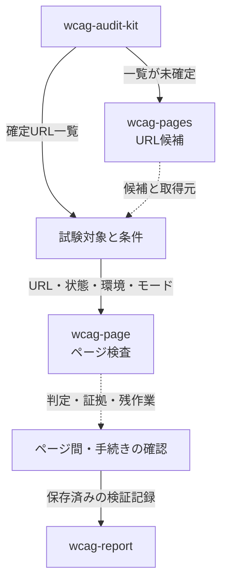
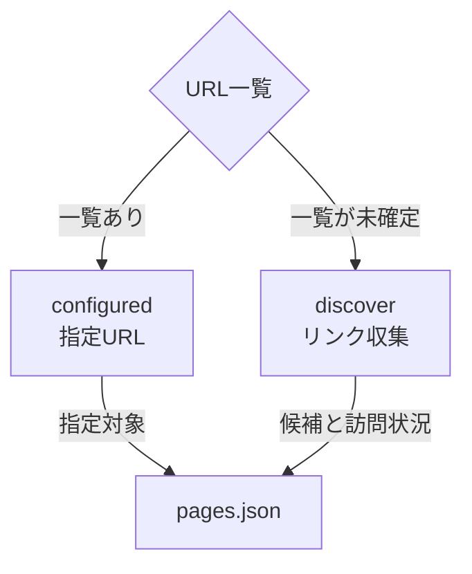
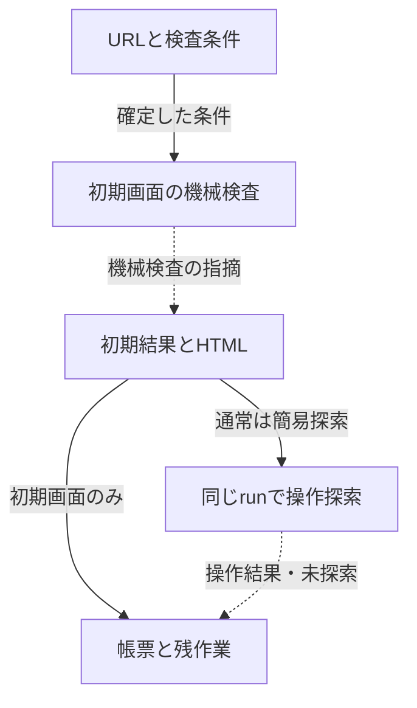
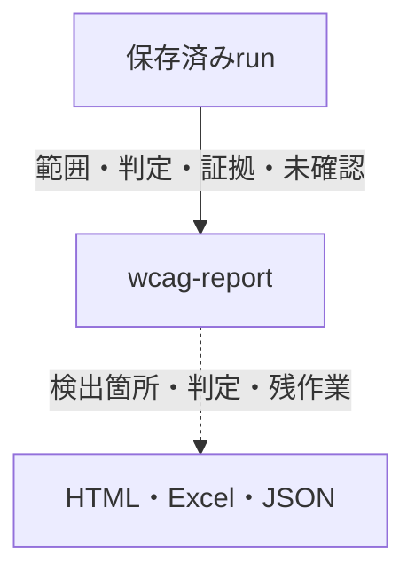
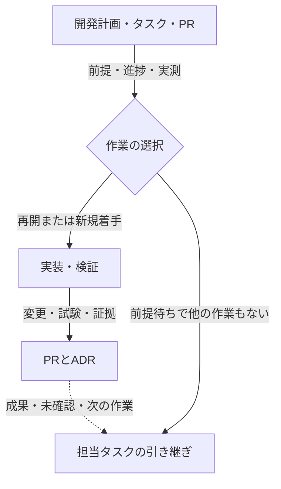
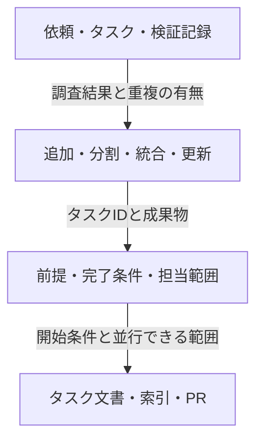

# WCAGスキルの全体像と検証の流れ

Webページを検査する人は、まず目的に合うスキルを1つ選びます。サイト全体の検証を頼むと、AIがURLの選定、ページごとの検査、報告を順に進めます。リポジトリを改善するための開発手順には、別の2スキルがあります。

この図はWCAG検証の手順を示します。検証モードは機械・AI・実スクリーンリーダーの使い方を選ぶ設定です。操作のつまずきと改善案を調べる場合は、`wcag-audit-kit` にアクセシビリティ点検を依頼します。[点検の手順](../skills/wcag-audit-kit/references/accessibility-review.md) · [VISION](VISION.md)

## 依頼の目的で、最初に使うスキルが決まる

| したいこと | 選ぶスキル | 最初に渡すもの | 受け取るもの |
| --- | --- | --- | --- |
| サイト全体を検証する | [wcag-audit-kit](../skills/wcag-audit-kit/SKILL.md) | 基準URL、対象範囲、既知のURLや認証条件 | 対象の選定理由、ページ別結果、サイトの報告、残る確認 |
| 検証するページを探す | [wcag-pages](../skills/wcag-pages/SKILL.md) | 基準URL、対象範囲、手元の一覧やサイトマップ | URL一覧、取得元、訪問できなかった箇所 |
| 1ページを検証する | [wcag-page](../skills/wcag-page/SKILL.md) | URL、適合レベル、検証モード、撮影範囲 | 機械検査の結果、証拠、判定、未確認の操作や観点 |
| 保存済みの結果をまとめる | [wcag-report](../skills/wcag-report/SKILL.md) | 検証記録のフォルダー、集計範囲 | HTML・JSON・Excel、残作業 |
| リポジトリの開発を進める | [wcag-dev](../.agents/skills/wcag-dev/SKILL.md) | 「進めて」または担当範囲の指定 | 実装・検証の記録、PR、次回の引き継ぎ |
| 開発タスクを追加・分割・統合する | [wcag-dev-tasks](../.agents/skills/wcag-dev-tasks/SKILL.md) | 整理したい課題と、その根拠になる依頼や検証記録 | タスク文書、依存関係、並行作業の範囲、PR |

監査用の4スキルは、AI環境のスキル選択機能で明示して始めます。例えばCodexでは `$wcag-page` を選び、URLと検査条件を伝えます。単独で使う `wcag-page`・`wcag-pages`・`wcag-report` はそれぞれのフォルダーだけで使えます。サイト全体を進める場合は4フォルダーを隣り合わせに置きます。 [配置と呼び出し方](../README.md#スキルとして使う)

実行するAIは `SKILL.md` を読み、必要な資料と補助コマンドを選びます。同梱のPython CLIがブラウザー操作と機械検査を行い、証拠と帳票を保存します。設定・証拠・判定をまとめた検証記録を `run` と呼びます。AIによる内容判断と実スクリーンリーダーでの確認は、選んだモードと実際に使える環境に従います。 [検証モードの仕様](../skills/wcag-audit-kit/references/verification-modes.md)

## wcag-audit-kit は試験対象を決め、ページごとの結果を集める

全体進行を担当するAIは、必要なスキルの `SKILL.md` をファイルとして読み、最初の依頼で決まった範囲と設定を引き継ぎます。 [wcag-audit-kit の実行手順](../skills/wcag-audit-kit/SKILL.md)

試験対象の選定、分担と再開

- 全体進行は、調べるURL、採用・除外の理由、全件かサンプルか、複数ページにまたがる手続きを記録します。ページ担当には、URLに加えて認証、表示環境、検査する状態、必要な操作手順を渡します。
- 共通のrunで分担する場合は、ページ別のタスクに判定と証拠を保存します。中断後は `tasks list` と `pending --task …` で担当と残作業を読みます。
- 確定したURL一覧を機械のみで検査する場合は、`page-batch` で順に処理します。`page-batch.json` にURLごとの帳票と未着手・中断・失敗が残ります。同じ条件でバッチを再開でき、各ページの検証状況はそのページの報告JSONで確認します。

[共同作業の記録](../skills/wcag-audit-kit/references/collaboration.md) · [指定URL一覧の実行手順](../skills/wcag-audit-kit/references/page-audit.md#指定url一覧を順に検査する)

## wcag-pages は指定URLを受け取るか、リンクから候補を集める

リンク収集では初期表示のリンクをたどり、取得元、未訪問、失敗を残します。サイトマップやログイン後・操作後のリンクは追加で調べる範囲に含めます。 [wcag-pages の実行手順](../skills/wcag-pages/SKILL.md)

## wcag-page は初期画面の結果を先に返し、同じrunで操作を調べる

直接の新規依頼では不足する設定をアクセス前にまとめて確認します。判断を任せた項目はAA・機械のみ・初期表示だけを採用し、初期結果を共有した後は、通常は同じrunで簡易探索を1回行います。依頼に応じて詳しい探索や、設定したモードでの追加検査に進みます。 [wcag-page の実行手順](../skills/wcag-page/SKILL.md)

操作候補の選び方、メニューとコンボボックスの実キー、差分再検査、証拠の読み方は[wcag-page の動作を追う（HTML）](WCAG-PAGE-WORKFLOW.html)にまとめています。HTMLファイルを手元のブラウザーで開いて読めます。

ブラウザーで行う操作と、既存runからの再開

- 初期画面ではPC幅とスマホ相当の幅で機械ルール（axeなど）を実行します。初期表示の撮影を選ぶと、操作前のページ全体を幅ごとに1枚保存します。
- 簡易探索では主要な操作を優先し、開閉する部品などを実際に操作して状態の変化を調べます。例えば、メニューを開くキーや、閉じた後のフォーカスの戻り先を確認します。探索上限で残った候補は帳票に記録します。
- 既存runのページ担当は、設定と証拠を引き継ぎ、`page-next` や `pending` で残る検査票を読みます。追加確認では、基準・状態・操作・観察結果を証拠と対応づけて保存します。
- ログインやアプリの起動が必要なら、対象固有の準備と到達手順を確認します。準備できなかった経路は未確認とし、必要な環境や操作を引き継ぎます。

[1ページの検査と再開](../skills/wcag-audit-kit/references/page-audit.md) · [操作と発話の確認方法](../skills/wcag-audit-kit/references/methods.md)

適合レベル・検証モード・撮影範囲

| 設定 | 決めること |
| --- | --- |
| 適合レベル（A・AA・AAA） | どの達成基準を確認するか |
| 検証モード | 機械検査に加えて、AIによる内容判断や実スクリーンリーダーでの確認を行うか |
| 撮影範囲 | 標準の証拠画像をどこで保存するか。撮影なし、初期表示だけ、状態ごと、操作途中も含める、から選ぶ |

| 検証モード | 機械ルール・実操作・数値計測 | AIによる画像・文章などの比較 | 実スクリーンリーダーの操作・発話 |
| --- | --- | --- | --- |
| `machine` | 実施 | 省略 | 省略 |
| `ai` | 実施 | 使用 | 省略 |
| `screen-reader` | 実施 | 省略 | 使用 |
| `full` | 実施 | 使用 | 使用 |

例えば画像に代替文があるかは機械で確認でき、画像の情報を代替文が伝えているかは内容を比較して判断します。モード表は使う手段を示します。証拠や実行環境が不足した観点は未確認に残します。レベル・モード・撮影設定を変える検査は、新しいrunに保存します。 [モードの対応範囲](../skills/wcag-audit-kit/references/verification-modes.md) · [画像の保存範囲](../skills/wcag-audit-kit/references/inspection-profiles.md)

## wcag-report は保存した判定と証拠から帳票を作る

指定されたrunで判定と証拠の対応を確かめ、保存済みの記録だけで報告を作ります。帳票ができても、未探索の操作や未判定の基準があれば検証は未完了です。 [wcag-report の実行手順](../skills/wcag-report/SKILL.md)

確認するファイルと、Excelの判定取り込み

| ファイル | 読み取れること |
| --- | --- |
| `reports/report.html` | 機械ルールが検出した箇所、達成基準ごとの記録、証拠、残る確認 |
| 閲覧用Excel | 行ごとの適否や未確認、再現手順、対象URLと状態 |
| `data/report.json` | 判定や残作業の件数、`audit_complete` による検証状態 |

従来形式のrunでは帳票がrun直下にあります。帳票内では、機械ルールの通過と、達成基準全体の判定を別々に確認できます。作業用Excelの判定を取り込む場合は、利用者から明示された記録更新として扱い、その後に報告を作ります。 [帳票の読み方](../skills/wcag-audit-kit/references/checksheet.md) · [閲覧用・作業用Excel](../skills/wcag-audit-kit/references/collaboration.md)

## wcag-dev は着手できる作業を選び、既定で1作業単位のPRまで進める

「進めて」と依頼すると、同じ目的の未完了作業を優先します。後続タスクの整理が必要なら `wcag-dev-tasks` の手順を読み、記録を整えます。PRのマージには別の指示が必要です。 [wcag-dev の実行手順](../.agents/skills/wcag-dev/SKILL.md)

複数の作業を任せる場合は、Codexで長期ゴールを明示します。完了条件に達するまで、着手できる次の作業へ進みます。[長期開発の手順](DEVELOPMENT-GOAL.md)

## wcag-dev-tasks は追加・分割・統合するタスクと、その開始条件を決める

タスク整理の依頼では、着手条件と完了の根拠を文書に残します。実装や監査の実行は、それも依頼されたときに始めます。 [wcag-dev-tasks の実行手順](../.agents/skills/wcag-dev-tasks/SKILL.md)
