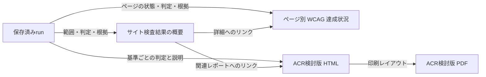

# 0132 保存済みrunから公開・提出用の帳票を並べて試す

- 日付 2026-11-23
- 状態 Proposed

## 背景

既存の検査票から対象範囲の結論と不適合箇所を読める。公開サイトの検査概要、ページごとの達成状況、調達先に渡すACRでは、読者が最初に必要とする情報が異なる。用意する項目と表示順を用途ごとに試せるようにする。[T045](../tasks/T045-report-prototypes.md)

## 決定

同じ保存済みrunから、独立したHTMLのサイト概要、ページ別達成状況、ACR検討版を出力する。ACR検討版には同じHTMLを使ったPDF出力を設ける。サイト概要からいずれの詳細にも移動できる。結論は `conformance`、基準ごとの判定は `checksheet` から読む。未確認と不適合の理由は両方表示する。製品のバージョンや報告日のように検査票で決まらない項目は、入力された値を表示する。[対象範囲の結論](0097-report-verified-scope-conformance.md)

## 代替案

既存の帳票に様式を切り替える設定を追加する案では、共通の表示項目を先に決めることになる。各様式を独立させることで、同じ結果について内容と読み順を比べてから共通部分を決められる。

## 影響

比較用の生成処理は `validation/development/T045/` に置き、指定した新規ディレクトリーへ書き出す。正式なACRへ進む際に、ITIの指定する版と判定語に沿って、検査票の判定をどのように記載するかを確認する。正式な発行に必要な情報と確認手順は、提出・公開向けの検証で扱う。[ITIのVPATとACRの説明](https://www.itic.org/voluntary-product-accessibility-template-vpat/)

## 検証方法

同じ試験台帳を使って、対象URL、基準、判定、残る確認、元の記録へのリンクを照合する。機械検査だけの候補は未確認として扱う。既存の適合例・不適合例と、2ページの合成例を使い、元台帳のファイルが一致すること、狭い画面とPDFで表が読めることを確かめる。[試作の再現方法](../../validation/development/T045/README.md)
